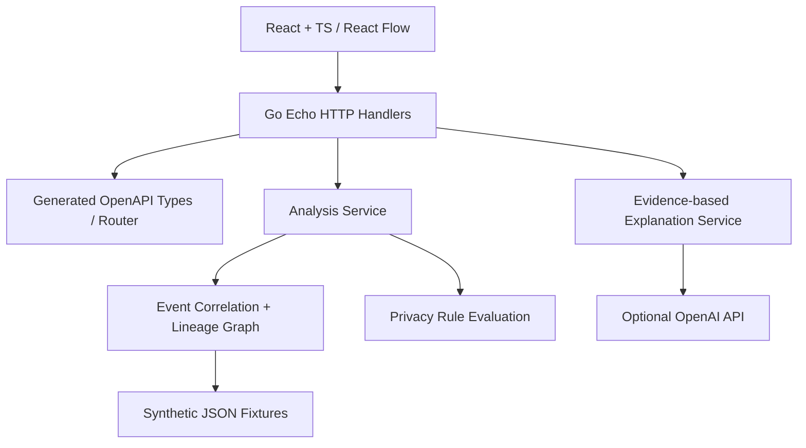

# Independent Architecture — Public Go Libraries Only

## System



No persistent storage. Single Go HTTP server and one frontend SPA.

## Target repo layout (directories are placeholders until coding begins)

```text
traceguard-ai/
├── README.md  AGENTS.md  PLANS.md
├── docs/
│   ├── 00-scope.md ... 11-quality-gates.md
│   └── ...
├── prompts/{FE1,FE2,BE1,BE2,RELEASE}.md
├── backend/
│   ├── go.mod                          # BUILD DAY
│   ├── Makefile                       # BUILD DAY
│   ├── docs/traceguard-api/doc.yaml   # BUILD DAY: OpenAPI source
│   ├── cmd/traceguard-api/
│   │   ├── main.go                    # BUILD DAY
│   │   └── handlers/http/
│   │       ├── api_gen/               # BUILD DAY: generated; NEVER edit by hand
│   │       ├── analyze.go
│   │       ├── scenarios.go
│   │       └── explain.go
│   ├── internal/
│   │   ├── config/
│   │   ├── domain/traceguard/core/
│   │   │   ├── entities/            # BE1 own shared domain types
│   │   │   ├── ports/               # BE1 own ports
│   │   │   └── services/
│   │   │       ├── lineage/         # BE1
│   │   │       ├── detection/       # BE2
│   │   │       └── investigation/   # BE2
│   │   └── adapters/
│   │       ├── fixtures/            # BE1
│   │       └── ai/                  # BE2
│   └── tests/
└── frontend/
    ├── package.json                 # BUILD DAY
    ├── vite.config.ts               # BUILD DAY
    └── src/
        ├── app/                     # FE1 — entry, layout, composition
        ├── features/
        │   ├── lineage/             # FE1 — React Flow
        │   └── investigation/       # FE2 — panels/scenario
        └── lib/
            ├── api/                 # FE2 — types + API calls
            └── fixtures/            # FE2 — mock payloads for UI development
```

## Design principles adapted from general public patterns
- **Contract-first:** write and review an OpenAPI 3 spec during build day; then generate backend DTOs and router glue.
- **Transport != domain:** keep Echo request/response handling separate from graph and rule algorithms.
- **Ports and adapters:** the analysis service uses interfaces for optional fixture and AI dependencies; no unnecessary abstraction for pure functions.
- **Generated code is disposable:** never manually edit API-generated files.
- **Evidence:** every observed edge must reference a real synthetic event ID; missing links explicitly flagged.
- **Lean scope:** no sqlc or repository layer unless actually adding persistence (not planned).

## Runtime dependencies
Use only public approved packages. Pin and document actual versions during build. No import paths from internal-company organizations.

## Clean-room note
This tree is an original hackathon-specific layout, not a clone of any private starter repository. Do not copy private framework implementation, CI configs, logging middleware or tooling into it.
